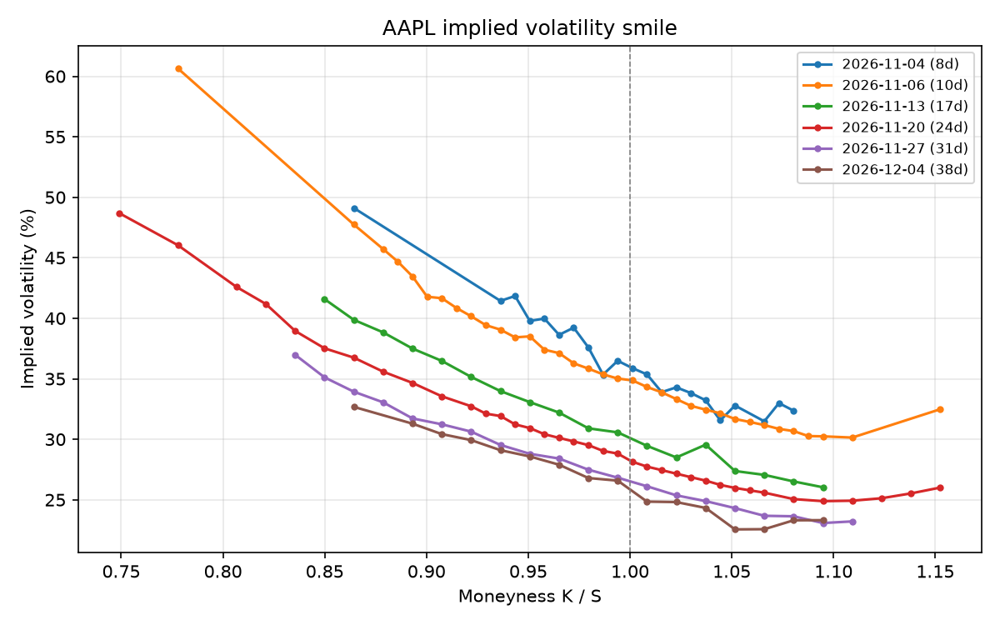

# US Equity Options Pricing Engine

C++17 pricer for American-style options on US stocks. It uses a Cox-Ross-Rubinstein binomial tree, gets Greeks from the same tree, backs out implied volatility from market prices, and spreads whole option chains across threads, pricing 10,000 American contracts in 175 ms on 11 cores. A small Python layer downloads real chains from Yahoo Finance and plots the IV smile.



AAPL chain from Oct 27, 2026. IV is higher at low strikes (the usual equity skew), and the short expiries sit well above the longer ones.

## Results

10,000 American contracts on a 500-step tree, Apple M3 Pro (11 cores):

| Threads | Pricing (ms) | Speedup | IV solve (ms) | Speedup |
|--------:|-------------:|--------:|--------------:|--------:|
| 1  | 1334.5 | 1.00x | 15092.7 | 1.00x |
| 4  | 359.1  | 3.72x | 4067.7  | 3.71x |
| 11 | 175.3  | 7.61x | 2003.3  | 7.53x |

Close to linear on the 5 performance cores, flatter once the 6 efficiency cores join in. IV solves scale almost exactly like plain pricing even though each one takes a different number of iterations.

American puts against finite-difference reference prices (K = 40, r = 6%, σ = 20%, T = 1):

| Spot | Tree (2000 steps) | Reference |
|-----:|------------------:|----------:|
| 36 | 4.4867 | 4.486 |
| 40 | 2.3194 | 2.319 |
| 44 | 1.1132 | 1.113 |

## How it works

- **Pricing:** CRR tree rolled back in a single $O(N)$ buffer, keeping the larger of exercise and hold at each node for American options.
- **Greeks:** delta, gamma and theta from the first two levels of the tree in the same pricing pass. Vega by bumping volatility.
- **Implied volatility:** Newton's method inside a shrinking bracket, falling back to bisection when vega is too small to trust. Price is continuous and increasing in σ, so a root inside the bracket is guaranteed to be found.
- **Threading:** workers take 16 contracts at a time from an atomic counter, so a thread stuck with slow IV solves doesn't leave the others idle. Chunks of 16 rather than 1 keep threads from contending on the counter. No locks; each result has its own slot.

## Testing

European prices and Greeks are checked against Black-Scholes, American puts against the reference prices above, and IV by round trips (price at a known σ, solve, recover it). Threaded output matches serial bit for bit. CI runs everything on Linux and macOS under AddressSanitizer, UBSan and ThreadSanitizer.

More on the design, the math and every check in [docs/DETAILS.md](docs/DETAILS.md).

## Build

```bash
cmake -S . -B build
cmake --build build --parallel
ctest --test-dir build --output-on-failure
./build/bench_batch
```

Python bindings and plots are covered in [docs/DETAILS.md](docs/DETAILS.md#build).