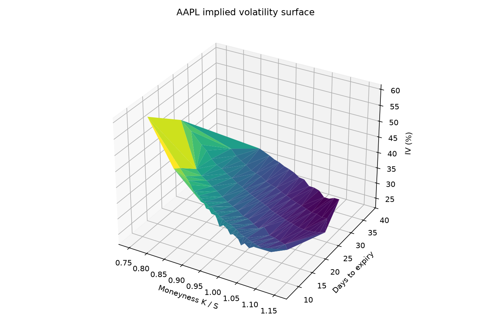

# Engineering notes

The longer version of the [README](../README.md): how each piece works, why it's built that way, and how I checked it.

## Benchmarks

### Threading

10,000 American contracts (50 expiries, 100 strikes, calls and puts) on a 500-step tree, Apple M3 Pro with 11 cores. Run with `./build/bench_batch`.

| Threads | Pricing (ms) | Speedup | IV solve (ms) | Speedup |
|--------:|-------------:|--------:|--------------:|--------:|
| 1  | 1334.5 | 1.00x | 15092.7 | 1.00x |
| 2  | 690.7  | 1.93x | 7899.7  | 1.91x |
| 4  | 359.1  | 3.72x | 4067.7  | 3.71x |
| 8  | 215.6  | 6.19x | 2455.5  | 6.15x |
| 11 | 175.3  | 7.61x | 2003.3  | 7.53x |

The M3 Pro has 5 performance cores and 6 efficiency cores. Scaling is close to linear up to 5 threads and flattens after that. If an efficiency core is worth roughly half a performance core, the ceiling is around $5 + 6 \times 0.55 \approx 8.3$x, so 7.6x is about 90% of what the chip can give.

IV solves take a different number of iterations per contract but scale almost exactly like plain pricing. With fixed slices per thread they'd scale noticeably worse, so this is the dynamic chunking paying off.

### Convergence

European ATM call (S = K = 100, r = 5%, σ = 20%, T = 1) against Black-Scholes, from `./build/convergence`:

| Steps | Tree price | Abs. error |
|------:|-----------:|-----------:|
| 100   | 10.430612 | 2.00e-02 |
| 200   | 10.440591 | 9.99e-03 |
| 400   | 10.445586 | 5.00e-03 |
| 800   | 10.448084 | 2.50e-03 |
| 1600  | 10.449334 | 1.25e-03 |
| 3200  | 10.449959 | 6.25e-04 |

Doubling the steps halves the error, the expected $O(1/N)$ rate for CRR. At small step counts it wobbles a bit depending on whether the strike lands on a node.

### American puts

No closed form exists, so these are checked against finite-difference reference prices for the standard Longstaff-Schwartz test case (K = 40, r = 6%, σ = 20%, T = 1):

| Spot | Tree (2000 steps) | Reference |
|-----:|------------------:|----------:|
| 36 | 4.4867 | 4.486 |
| 40 | 2.3194 | 2.319 |
| 44 | 1.1132 | 1.113 |

## How it works

### Pricing

Each step the stock goes up by $u = e^{\sigma\sqrt{\Delta t}}$ or down by $d = 1/u$, with risk-neutral up probability

$$p = \frac{e^{(r-q)\Delta t} - d}{u - d}$$

$p$ isn't a real-world probability. It's chosen so the stock grows at the risk-free rate on average, which is what makes the price independent of anyone's view on where the stock is going. If $p$ falls outside $(0, 1)$ the tree isn't valid, so the pricer throws instead of returning nonsense.

Values start at the payoff on expiry and get rolled back one step at a time in a single buffer of $N+1$ doubles: $O(N^2)$ time, $O(N)$ memory. For American options each node keeps

$$\max(\text{exercise now},\ \text{discounted expected value of holding})$$

which is dynamic programming, so the local choice gives the optimal exercise strategy.

### Greeks

The tree has already computed values at nearby stock prices, so most Greeks come from finite differences on the first two levels:

- **Delta:** slope between the two nodes at step 1.
- **Gamma:** how much that slope changes across the three nodes at step 2.
- **Theta:** the middle node at step 2 has the same stock price as the root, so the change in value there is pure time decay over $2\Delta t$.
- **Vega:** volatility changes the shape of the tree rather than moving along it, so it takes two extra pricings with σ bumped up and down.

### Implied volatility

The solver looks for the σ where model price equals market price, i.e. a root of

$$f(\sigma) = V(\sigma) - V_{\text{market}}$$

This part turned into a nice bit of real analysis. $V$ is continuous and strictly increasing in σ, so:

- **Existence** is the intermediate value theorem (Bolzano's version): if $f(\sigma_{\text{lo}}) < 0 < f(\sigma_{\text{hi}})$, a root lies in between.
- **Uniqueness** comes from strict monotonicity.
- **Bisection** is the nested-interval proof of Bolzano's theorem run as code. Halve the bracket, keep the half where the sign changes, repeat.

The solver uses Newton's method for speed, with vega from a central difference, and keeps the bracket updated every iteration. If a Newton step would leave the bracket, or vega is too small to trust (short-dated or far out of the money), it takes a bisection step instead. Bisection only needs continuity, which holds even where the tree's price has small kinks in σ, so it can't fail when a root exists. Typical near-the-money solves finish in 3 to 6 Newton steps.

The cases where the theorem's hypotheses break became explicit results instead of silent garbage:

| Status | What failed | Example |
|---|---|---|
| `NoSolution` | The sign condition: the price is outside what any σ can produce | A call quoted above the stock price |
| `Undetermined` | Strict monotonicity: price is flat in σ, so the root isn't unique | A deep in-the-money American put trading at exactly $K - S$ |
| `NotConverged` | Iteration limit | Shouldn't happen with the bracket, but reported honestly |

### Threading

Contracts are independent, so a chain is embarrassingly parallel. Workers grab 16 contracts at a time from a shared atomic counter (`fetch_add`) instead of splitting the chain into fixed slices up front. Fixed slices would leave threads idle while one finishes a run of slow IV solves, and on the M3 the efficiency cores would hold everyone up too.

- The counter is the only shared state. Each result goes into its own slot, so there are no locks.
- Chunks of 16 rather than 1 keep threads from fighting over the counter's cache line.
- An exception escaping a `std::thread` would call `std::terminate`, so each worker catches it, stops the others, and the calling thread rethrows it.
- The Python binding releases the GIL during the batch call, so Python isn't blocked while the C++ threads run.

### Design

The IV solver, the batch code and the Python bindings only see a one-method `Pricer` interface, not the tree. The tests run the solver against `BlackScholesPricer` as well, and a Monte Carlo pricer could be dropped in without touching anything else.

### Real data

`fetch_chain.py` downloads the chain from Yahoo Finance and measures time to expiry to 4pm New York time on expiration day. `iv_surface.py` keeps only quotes worth trusting before solving:

- out-of-the-money options only (the liquid side, and almost all time value)
- a two-sided quote with a spread under 50% of mid
- at least 7 days to expiry
- strike between 0.7 and 1.3 times spot

Mid price stands in for the market price.



## Testing

- European tree prices converge to Black-Scholes and satisfy put-call parity to $10^{-9}$. Parity is exact rather than approximate because the tree uses the same risk-neutral drift.
- American calls with no dividends match European calls exactly, since early exercise never pays there. With a high dividend yield they're worth more.
- American puts match the reference prices above and are never worth less than the European put or the exercise value. A put deep enough in the money is exercised immediately.
- Tree Greeks match the closed-form Black-Scholes Greeks, which are themselves checked against bumped prices first.
- IV round trips: price at a known σ, solve, and recover it to $10^{-4}$ for vols from 12% to 110%, across strikes, calls, puts, European and American.
- Batch output is bit-identical to a serial loop for every thread count, and a worker exception reaches the caller.
- Python tests cover the bindings, including impossible quotes coming back as NaN.
- CI builds and tests on Linux and macOS under AddressSanitizer and UBSan, runs the threading tests under ThreadSanitizer, and builds and tests the Python module.

## Build

```bash
cmake -S . -B build
cmake --build build --parallel
ctest --test-dir build --output-on-failure

./build/convergence
./build/bench_batch            # optional args: tree steps, max threads
```

Python bindings and plots:

```bash
python3 -m venv .venv && source .venv/bin/activate
pip install -r python/requirements.txt

cmake -S . -B build -DBUILD_PYTHON=ON \
  -DPython_EXECUTABLE="$(which python)" \
  -Dpybind11_DIR="$(python -m pybind11 --cmakedir)"
cmake --build build --target options_engine

cd python
python fetch_chain.py AAPL --rate 0.04 --div-yield 0.005
python iv_surface.py ../data/AAPL_chain.csv
```

Set `--rate` to the current 3-month T-bill yield. Quotes are cleanest during market hours.

## Limitations

- Volatility and rates are constant within a pricing, and dividends are a continuous yield rather than discrete payments.
- CRR prices wobble with the step count, so Greeks from small trees are noisy.
- Mid price is rough when quotes are wide or stale.
- The surface is raw quotes triangulated together, not a fitted model like SVI, so thin strikes make it bumpy.

## Next

A Least-Squares Monte Carlo (Longstaff-Schwartz) pricer behind the same `Pricer` interface, cross-checked against the tree.
